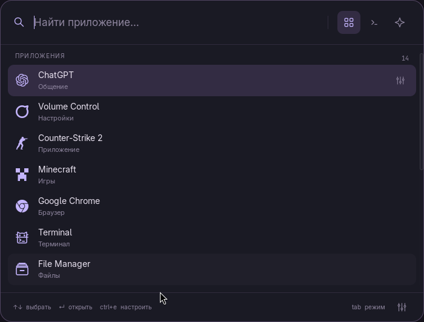
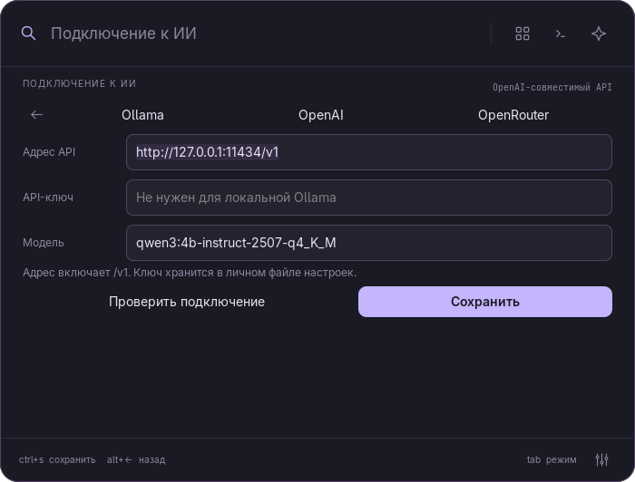

# Луч

Минималистичный нативный лаунчер для Wayland: приложения, shell и ИИ в одном окне. GTK 3 + layer-shell; без браузерного движка. Тема Graphite Lavender сочетает графитовые оттенки Sway и Waybar с лавандовым акцентом кастомной темы ChatGPT Desktop. Все значки монохромные.



Первый `toggle` открывает приложения; следующие переключают **приложения → shell → ИИ**. `Esc` закрывает окно и отменяет текущую работу. Небольшой фоновый процесс остаётся для мгновенного повторного открытия.

## Установка

Выполни в терминале от своего пользователя. Нужен `curl`.

```sh
curl -fsSL https://raw.githubusercontent.com/butukay/luch/refs/heads/master/install.sh | bash
```

Для окна нужна Wayland-сессия с протоколом [Layer Shell](https://github.com/wmww/gtk-layer-shell#supported-desktops), например Sway, Hyprland, labwc или KDE Plasma на Wayland. Установщик ставит недостающие зависимости через `sudo` в Arch Linux, Debian 12+, Ubuntu 24.04+ и Fedora. Для других дистрибутивов заранее установи системный Python 3.11+, PyGObject, Cairo, GTK 3 и GTK Layer Shell.

Установка сохраняет программу в `${XDG_DATA_HOME:-$HOME/.local/share}/luch/source` и создаёт команду `~/.local/bin/luch`. Для обновления повтори команду установки. [Ollama и другие ИИ-сервисы](#подключение-к-ии) подключаются отдельно.

Открой Луч командой `~/.local/bin/luch toggle` или назначь её на клавишу в настройках композитора. При доступном пользовательском systemd установщик включает фоновый сервис. В остальных сессиях фоновый процесс запускается при первом открытии.

Чтобы заменить существующий запуск fuzzel в Sway и Waybar, добавь `--integrate` после `| bash -s --`. Флаг `--no-start` откладывает запуск сервиса.

Из локального клона можно установить командой `./scripts/install --no-integrate` после установки зависимостей. При таком способе оставь клон на месте.

## Управление

| Действие | Клавиша |
|---|---|
| Следующий режим | Повторный toggle или `Tab` |
| Предыдущий режим | `Shift+Tab` |
| Выбрать режим напрямую | `Alt+1` / `Alt+2` / `Alt+3` |
| Выбрать результат | `↑` / `↓` |
| Запустить приложение / команду / запрос | `Enter` |
| Выполнить shell-команду в терминале | `Shift+Enter` |
| Закрыть окно | `Esc` |
| Настройки | `Ctrl+,` |
| Настроить выбранное приложение | `Ctrl+E` / `F2` / правая кнопка мыши |
| Все приложения, включая скрытые | `Ctrl+Shift+E` |
| Скрыть выбранное приложение | `Ctrl+H` |
| Показать скрытые приложения | `Ctrl+Shift+H` |

Режимы можно выбирать и тремя значками справа от строки ввода. Скрытие приложения влияет только на список Луча, не удаляет приложение и не меняет его desktop-файл.

Приложения используют узнаваемые монохромные значки: приглушённые в списке и чуть светлее в выбранной строке. Активный режим отмечен мягким оттенком акцента темы.

В окне нет логотипа и подписи с названием лаунчера: остаются строка ввода, результаты и подсказки управления.

```sh
luch toggle               # открыть или переключить режим
luch apps                 # открыть приложения
luch shell                # открыть shell
luch ai                   # открыть ИИ
luch list                 # desktop ID приложений
luch hide steam.desktop
luch unhide steam.desktop
luch settings             # открыть настройки
luch config               # путь к config.toml
luch status               # состояние лаунчера
luch doctor               # диагностика окружения
luch quit                 # остановить фоновый процесс
```

## Настройки приложений

Нажми **Ctrl+E** или **F2** на выбранном приложении; также можно нажать значок настроек в его строке или правую кнопку мыши. Для общего менеджера открой **Настройки → Настройки приложений…** либо нажми **Ctrl+Shift+E**. В менеджере видны и скрытые приложения.

Карточка позволяет изменить:

- название и подпись в списке;
- алиасы для поиска, например `web`, `хром` или `работа`;
- скрытие и закрепление в начале списка;
- команду запуска, рабочую папку и запуск в терминале;
- собственный значок: имя из системной темы или путь к файлу.

Новое название и алиасы участвуют в поиске вместе с исходным названием. Закреплённые приложения идут перед недавними. Скрытые остаются доступны в менеджере приложений. Эти изменения сохраняются только в конфигурации лаунчера; установленные приложения и их desktop-файлы не меняются.

**Ctrl+S** или кнопка **Сохранить** применяет изменения. В карточке `Tab` перемещается между полями; **Alt+←** возвращает в список. Кнопка **Сбросить** возвращает исходные параметры выбранного приложения и снимает его скрытие. Остальные приложения и общие настройки сохраняются.

Те же параметры можно задать вручную:

```toml
[apps.overrides."google-chrome.desktop"]
name = "Браузер"
aliases = ["web", "хром", "интернет"]
subtitle = "Рабочий профиль"
pinned = true
hidden = false
command = "google-chrome --incognito"
cwd = "~"
terminal = false
icon = "google-chrome-symbolic"
```

Пустые название, подпись, команда, рабочая папка и значок используют исходные значения. Отсутствующий `terminal` наследует способ запуска приложения. Команда запуска состоит из программы и аргументов; конструкции shell можно задать явно через `bash -c '…'`.

## Внешний вид

Настройки — `~/.config/luch/config.toml`. Изменения применяются при следующем открытии окна. Встроенные настройки доступны по `Ctrl+,`.

При переключении через **Super** или `Tab` окно сохраняет ширину, высоту и положение во всех трёх режимах. Длинные списки, вывод команд, ответы ИИ и настройки прокручиваются внутри. Ширина и число строк по-прежнему настраиваются; изменение параметров размера пересчитывает общую геометрию окна.

```toml
[window]
width = 700
rows = 7
radius = 20
padding = 20
position = "center"       # center, top, bottom
opacity = 1.0
font = "Adwaita Sans"
font_size = 14
row_height = 52
monitor = ""              # пусто — текущий монитор

[theme]
background = "#14121b"
surface = "#1c1926"
selection = "#35303f"
text = "#ede9f5"
muted = "#a49caf"
accent = "#a78bfa"
border = "#454050"
success = "#a5c9ad"
error = "#ef9aa9"

[apps]
hidden = []
favorites = ["google-chrome.desktop", "kitty.desktop", "thunar.desktop"]

[shell]
cwd = "~"
timeout = 30
terminal = "kitty"
```

Цвета задаются в формате `#RRGGBB`. Для цветов, не заданных в `[theme]`, Луч использует стандартную палитру. Чтобы вернуть её целиком, удали секцию `[theme]`. Прозрачность окна настраивается отдельно; размытие зависит от композитора.

## Подключение к ИИ

Открой **Настройки → Подключение к ИИ…** или кнопку подключения в режиме помощника.
Укажи базовый адрес OpenAI-совместимого API с `/v1`, ID модели и API-ключ.
Для локальной Ollama ключ можно оставить пустым. Есть быстрые адреса Ollama,
OpenAI и OpenRouter; любой другой совместимый адрес можно ввести вручную.
Кнопка проверки получает список моделей без генерации ответа. **Ctrl+S** сохраняет
настройки и начинает новый диалог с выбранным подключением.



Ключ скрыт в поле ввода и сохраняется в `~/.config/luch/config.toml` с правами `0600`.
Запросы и вызовы shell идут через потоковый Chat Completions API. Выбранная модель
должна поддерживать вызовы инструментов для предложений команд.

При подключении к локальной Ollama укажи `http://127.0.0.1:11434/v1`
и ID модели, установленной на сервере. Через совместимый API размер контекста
задаётся на стороне сервера или модели.

Для подключения из терминала:

```sh
"${XDG_DATA_HOME:-$HOME/.local/share}/luch/source/scripts/setup-ai" \
  --endpoint http://127.0.0.1:11434/v1 --model qwen3:4b-instruct-2507-q4_K_M
# Для удалённого сервиса можно добавить --api-key-env OPENAI_API_KEY.
```

ИИ отвечает коротко, а для действий предлагает shell-команду. Перед выполнением показывается сама команда; `Enter` подтверждает запуск. Результат передаётся модели для итогового ответа. `Ctrl+Backspace` отклоняет предложенную команду; `Esc` отменяет запрос или текущую команду.

Следующие вопросы в открытом окне продолжают диалог: помощник помнит предыдущие сообщения, вызванные команды и их вывод. Вопросы, ответы и результаты команд остаются в прокручиваемой истории. После выполнения или отклонения команды можно сразу ввести уточнение. Закрытие и повторное открытие окна начинает новый диалог.

```toml
[ai]
endpoint = "http://127.0.0.1:11434/v1"
model = "qwen3:4b-instruct-2507-q4_K_M"
api_format = "openai"
api_key = ""
num_predict = 384
temperature = 0.2
timeout = 60
```

## Проверка и сервисы

```sh
systemctl --user status luch
journalctl --user -u luch -n 80
```

Если Wayland-сессия перезапустилась, сервис получает актуальное окружение при повторном запуске установщика. Ручной вариант:

```sh
systemctl --user import-environment WAYLAND_DISPLAY DISPLAY SWAYSOCK XDG_CURRENT_DESKTOP
systemctl --user restart luch
```

## Удаление

```sh
"${XDG_DATA_HOME:-$HOME/.local/share}/luch/source/scripts/uninstall"
```

При установке из локального клона запусти `./scripts/uninstall` из каталога проекта. Скрипт удаляет пользовательские ссылки и сервис лаунчера, возвращает изменённые команды Sway и Waybar. Журнал и резервные копии лежат в `~/.local/state/luch/`. Скрипт сообщает о файлах и строках, изменённых вручную, и сохраняет их. Конфигурация, история, модели и каталог исходников сохраняются.
